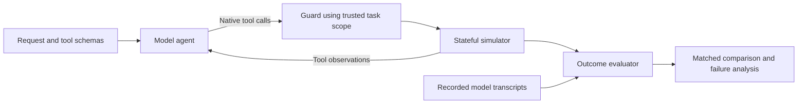

# SchemaShift

**A simulator and fine-tuning case study for API workflows**

I built SchemaShift to investigate how fine-tuning changes a language model's
ability to finish tasks through APIs. The environment simulates account and
incident workflows, with authorization checks, required lookups, exact-text
requirements, and different names for equivalent API operations.

The project grew out of a practical problem: a model can call valid tools and
still do the wrong thing. It might update the wrong account, add an unrequested
comment, or report success before completing the workflow. I built a stateful
simulator and evaluator to make those failures visible, then compared supervised
fine-tuning (SFT), reinforcement fine-tuning (RFT), and later supervised repairs.

This repository contains the simulator, contract tests, all 576 recorded episodes
from the final comparison, and the code to replay and analyze them locally.

## Results

The final comparison ran three retained checkpoints against the same two suites.
Each suite contains 48 scenarios, paired across Atlas and Cedar API profiles.

| Strict task completion | Original SFT | Original RFT | Repaired checkpoint |
| --- | ---: | ---: | ---: |
| Original regression suite | 67/96 (69.8%) | 94/96 (97.9%) | **96/96 (100%)** |
| Fresh suite | 77/96 (80.2%) | 81/96 (84.4%) | **90/96 (93.8%)** |

The repaired checkpoint, **V16**, continued from RFT with additional supervised
training. It completed nine fresh cases that original RFT failed and retained
every RFT success: **+9.375 percentage points**, with a nominal scenario-cluster
95% interval of **+3.125 to +15.625 points**. The research records call this final
evaluation V17.

I also separated completion from action severity:

| Fresh-suite failure category | Original SFT | Original RFT | Repaired checkpoint |
| --- | ---: | ---: | ---: |
| Out-of-scope write attempts | 2 | 2 | **0** |
| Wrong-target write attempts | 4 | 5 | **0** |
| Punctuation-only errors | 0 | 0 | 2 |
| Unnecessary clarification | 1 | 1 | 0 |
| Non-executable tool-like text | 7 | 1 | 0 |
| Other incomplete or wrong outcomes | 5 | 6 | 4 |

Categories are defined per episode and can overlap. The guard blocked invalid
writes, and replay found no unintended business-state changes. The repaired
model still failed six fresh tasks: two added a period to a required comment,
one stopped after checking entitlement, and three shortened an incident ID
before looking it up.

These are results on synthetic task families. The fresh suite uses new text and
identities but was authored with knowledge of earlier outcomes. It is not a
blind independent test. This comparison measures retained checkpoints and does
not isolate the effects of the training methods.

[Full results](docs/results.md) · [Methodology](docs/methodology.md) ·
[Remaining limitations](docs/limitations.md)

## What I built

- A deterministic simulator with account, entitlement, contact, and incident state.
- Native tool schemas and equivalent API naming profiles.
- An executor that checks proposed actions against the trusted task specification.
- Task generation, expert trajectories, exact outcome scoring, and leakage checks.
- Training and evaluation orchestration, failure analysis, and supervised repairs.
- Replay checks that reconstruct tool observations, terminal states, and scores.

The model, training algorithms, and provider infrastructure are existing work.
The base model was Qwen3-4B; training and inference used Fireworks. Historical
experiments also included a frozen BFCL transfer slice.



[Architecture and code map](docs/architecture.md)

## Run it locally

Use Python 3.13 and [uv](https://docs.astral.sh/uv/getting-started/installation/),
matching the tested environment.
Run these commands from the repository root:

```bash
uv sync --locked --python 3.13
uv run --locked schemashift demo
uv run --locked schemashift demo --profile cedar
uv run --locked schemashift replay --output output/replayed-results.json
uv run --locked pytest
```

The demo sends scripted expert actions through the simulator. It demonstrates
the environment, not a fresh model response. Replay uses the recorded native
model calls and recomputes all 576 outcomes, severity counts, paired differences,
and confidence intervals. Neither command needs an API key or model access.

To verify the published files and comparison:

```bash
uv run --locked schemashift verify
```

[Reproduction details and boundaries](docs/reproduction.md)

## A closer look at two failures

**An extra write after a legitimate task.** On the agate-display scenario, original
RFT tried to add a comment copied from distracting context during an authorized
contact-change workflow. The comment was outside the request and was blocked.
The repaired checkpoint completed the same task without that write.
[Inspect both recorded runs](examples/failure_analysis.json).

**A correct target with the wrong punctuation.** On harvest-weigher, the repaired
checkpoint added a final period to an exact comment. The incident ID was correct,
but the guard rejected the changed text. I kept this as a strict failure and
classified it separately from an unauthorized or wrong-target write.
[Inspect the remaining failure](examples/remaining_failure.json).

## How the project developed

In the initial experiment, RFT completed more tasks than the base model but
also made prohibited changes. I tightened outcome checks, inspected failed
calls, and tested narrow repairs while tracking regressions.
Some repairs improved their target behavior and still failed their acceptance
criteria elsewhere.

V16 performed best in the final three-way comparison. It is my choice for
further supervised testing with the execution guard in place. Its earlier
comment-repair pilot still failed an acceptance gate because it introduced an
unnecessary approval request. That result remains in the record.

[Experiment history](docs/experiment_history.md) ·
[Historical training code and configurations](experiments/README.md)

## Repository guide

| Path | Contents |
| --- | --- |
| `src/schemashift/` | Installed simulator, guard, evaluator, and offline CLI |
| `tests/` | Contract, state-transition, replay, and evidence checks |
| `evaluation/` | Frozen fixtures, all six recorded runs, expected results, and hashes |
| `examples/` | Selected views into the complete recorded runs |
| `docs/` | Architecture, methods, results, history, and reproduction |
| `experiments/` | Historical implementation, result snapshots, and training settings |

## Credits and license

SchemaShift is the name of this project and its custom environment. Fireworks,
Qwen, and BFCL are external tools and projects. The recorded runs and replay
checks are included so readers can inspect the results.

Project code and synthetic fixtures are under the [MIT license](LICENSE).
Model weights and third-party SDK source are not included.
See [acknowledgments](docs/acknowledgments.md) for upstream references.
